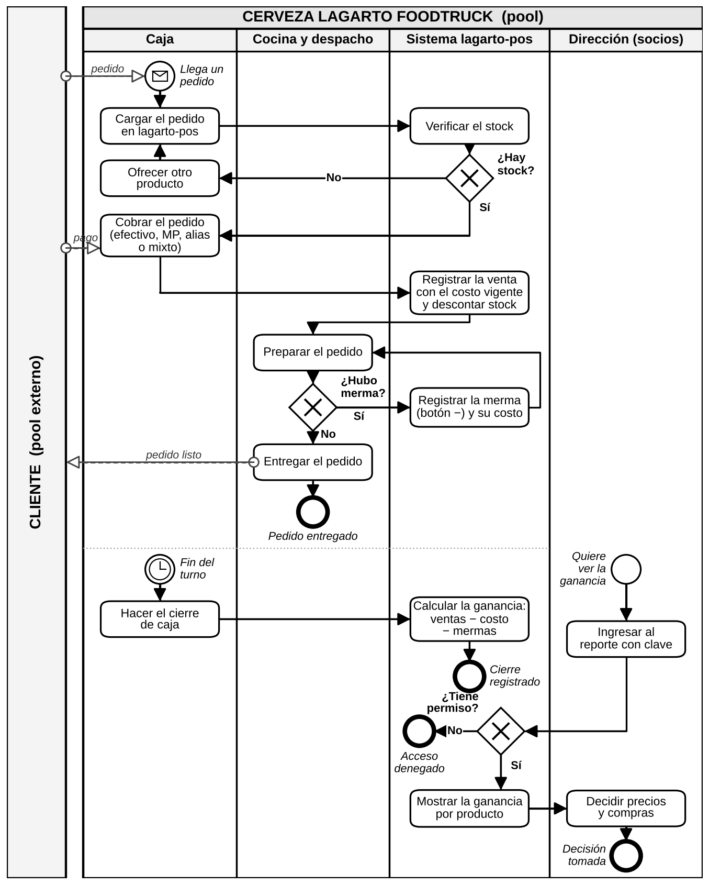

# Proceso de venta, merma y cierre (BPMN)

## Participantes

- **Pool Cliente** (actor externo): se muestra como caja negra. Se comunica con la empresa por **flujos de mensaje** (línea de trazos): el pedido, el pago y la entrega.
- **Pool Cerveza Lagarto Foodtruck**, con cuatro **lanes**:
  - **Caja:** carga el pedido, cobra y hace el cierre.
  - **Cocina y despacho:** prepara y entrega el pedido.
  - **Sistema lagarto-pos:** el comportamiento automatizado (stock, registro de la venta y de la merma, cálculo de ganancia, control de acceso).
  - **Dirección (socios):** consulta la ganancia y decide precios y compras.

## Flujo estándar

Llega un pedido → se carga en lagarto-pos → el sistema verifica el stock → se cobra → el sistema registra la venta con el costo vigente y descuenta el stock → se prepara y se entrega el pedido.

Al **fin del turno** (evento de temporizador), la caja hace el cierre y el sistema calcula la ganancia: ventas − costo − mermas. Cuando un socio quiere ver la ganancia, ingresa con clave.

## Compuertas de excepción (exclusivas)

| Compuerta | Excepción | Qué pasa |
|---|---|---|
| ¿Hay stock? | No hay stock del producto | La caja ofrece otro producto y vuelve a cargar el pedido |
| ¿Hubo merma? | Se rompió o se quemó mercadería | Se registra la merma con el botón "−" y su costo, y se vuelve a preparar |
| ¿Tiene permiso? | Un usuario sin permiso intenta ver costos | Acceso denegado: el sistema oculta costos y ganancias |

## Qué cambia con el sistema

Hoy la venta, el stock, las mermas y el cierre ya pasan por lagarto-pos. Las tareas nuevas de la próxima etapa son **registrar la venta con el costo vigente**, **registrar el costo de la merma**, **calcular la ganancia** y **controlar el acceso con clave**.
